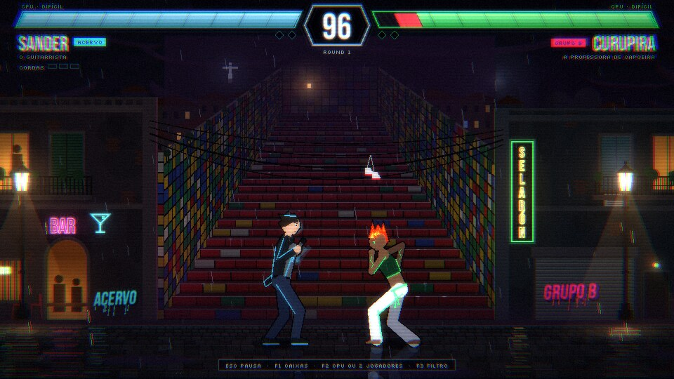
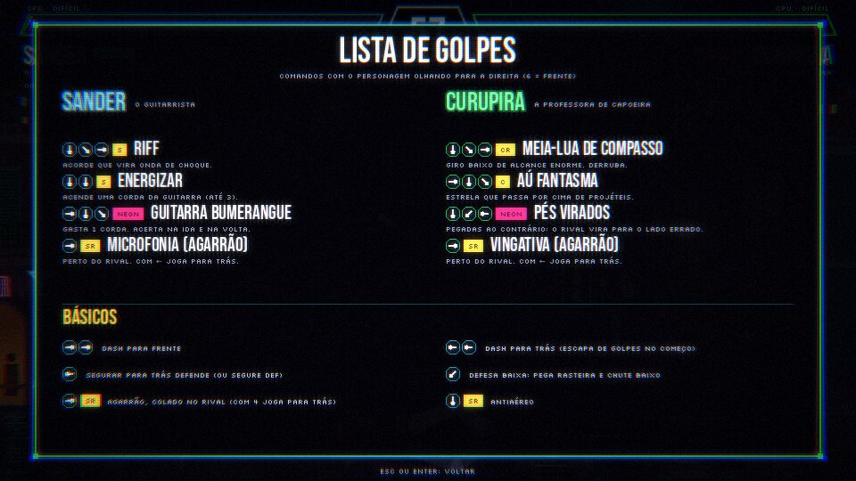

# ACERVO GUERRA CIVIL

Jogo de luta 2D, spin-off do ACERVO GAME. Rio de Janeiro sombrio e neon, **ACERVO x GRUPO B**.

Este repositório está sendo construído por partes. **Parte 1:** a luta 1x1 jogável, com
Sander (ACERVO) x Curupira (GRUPO B) na Escadaria Selarón, HUD de vida, rounds e cronômetro.



## Como jogar

1. Baixe o [Godot 4](https://godotengine.org/download) (a versão padrão, não precisa da .NET).
   Testado no 4.7.2; deve abrir a partir do 4.3.
2. Abra o Godot, clique em **Importar**, escolha o `project.godot` desta pasta e depois **Importar e Editar**.
3. Aperte **F5** (ou o ▶ no canto superior direito).

Na primeira vez o Godot importa as fontes e os sons, leva alguns segundos.

Por padrão você é o P1 (Sander) contra a CPU (Curupira). **F2** troca para 2 jogadores, e na pausa
dá para trocar de personagem, mudar a dificuldade e reiniciar.

## Controles

| Ação | P1 teclado | P2 teclado | Controle |
|---|---|---|---|
| Mover | W A S D | Setas | Analógico / direcional |
| Soco fraco (SF) | U | Num 4 | X |
| Soco forte (SR) | I | Num 5 | Y |
| Chute fraco (CF) | J | Num 1 | A |
| Chute forte (CR) | K | Num 2 | B |
| Defesa (DEF) | O | Num 6 | RB |
| NEON | L | Num 3 | LB |
| Pausa | Esc | Esc | Start |

O 1º controle conectado é do P1 e o 2º do P2. As teclas usam a posição física, então funcionam igual
em teclado ABNT2 e US. Para remapear, crie as ações (`p1_sf`, `p2_cima`...) no Mapa de Entrada do
projeto e elas passam a valer no lugar das padrão.

| Tecla | Função |
|---|---|
| F1 | Mostra as caixas de acerto (vermelho), de dano (verde) e de empurrão (azul) |
| F2 | P2 alterna entre CPU e jogador 2 |
| F3 | Liga e desliga o filtro CRT |
| F11 | Tela cheia |

## Golpes

Comandos com o personagem olhando para a direita, em notação de teclado numérico
(`2` = baixo, `6` = frente, `4` = trás, `236` = ↓↘→, `214` = ↓↙←, `623` = →↓↘). A lista
também está na pausa, em **Lista de golpes**.



**Sander, o Guitarrista (ACERVO)**

| Golpe | Comando | O que faz |
|---|---|---|
| Riff | 236 + SF ou SR | Acorde que vira onda de choque (com SR a onda sai mais rápida) |
| Energizar | 22 + SF ou SR | Acende uma corda da guitarra (até 3) |
| Guitarra Bumerangue | 623 + NEON | Gasta 1 corda; acerta na ida e na volta |
| Microfonia (agarrão) | 6 + SR colado no rival | Com 4 joga para trás |

**Curupira, a Professora de Capoeira (GRUPO B)**

| Golpe | Comando | O que faz |
|---|---|---|
| Meia-Lua de Compasso | 236 + CR | Giro baixo de alcance enorme; derruba |
| Aú Fantasma | 623 + CF ou CR | Estrela que passa por cima de projéteis |
| Pés Virados | 214 + NEON | Pegadas ao contrário: quem pisa vira para o lado errado |
| Vingativa (agarrão) | 6 + SR colado no rival | Com 4 joga para trás |

**Básicos:** 66 dash para frente, 44 dash para trás, segurar trás (ou DEF) defende, 1 defende
baixo (rasteiras e chutes baixos), 2 + SR é antiaéreo. Golpes fracos emendam nos fortes e
qualquer golpe que encosta pode ser cancelado num especial.

## O que já tem

- Luta melhor de 3, round de 99 s, KO, tempo esgotado, empate e PERFEITO.
- Lógica em passo fixo de 60 fps e determinística (base para replay e online com rollback no futuro).
- Leitura de comandos com tolerância (meia-lua, dragão, 22, dash), defesa alta e baixa, agarrão,
  antiaéreo, combos com escala de dano, hitstop, câmera que acompanha e dá zoom no KO.
- CPU com 3 dificuldades (fácil, normal, difícil) que usa todos os especiais e pune erros.
- Arena Escadaria Selarón com parallax, chuva, neon piscando, Cristo ao fundo e reflexos no chão.
- HUD com barra de vida inclinada e vida fantasma, contador de combo, cordas do Sander e anúncios.
- Pausa com lista de golpes, controles, dificuldade, trocar personagens e revanche.
- Sons e música (synthwave com batida de funk) e voz do anunciador pelo sistema
  (Windows ou macOS com voz em português instalada).

## O que ainda é provisório

- **Arte:** personagens e arena são desenhados por código. Quando chegarem as referências e os sprites,
  dá para trocar o desenho sem mexer na luta (fica tudo em `scripts/visual/` e `scripts/arena/`).
- **Habilidades:** Sander e Curupira usam a versão do GDD. Quando vierem as do primeiro ACERVO GAME,
  é só ajustar `scripts/personagens/`.
- **Sons:** são sintetizados por `ferramentas/gerar_sons.py` (precisa de Python 3 e numpy). Para trocar
  um som por um de verdade, salve outro `.wav` com o mesmo nome em `audio/sfx/`.

## Testes

```sh
godot --headless res://testes/testes.tscn
```

Testa a leitura de comandos nos dois lados, roda 12 lutas CPU x CPU (procurando travamentos,
lutador fora da arena e especiais nunca usados) e confere que a mesma semente dá a mesma luta.
Sai com código 0 quando tudo passa.

Para gerar capturas de tela de uma luta CPU x CPU (precisa de janela, não roda com `--headless`):

```sh
godot res://ferramentas/capturas.tscn -- /pasta/de/saida 3
```

## Estrutura

```
cenas/luta.tscn        cena principal (a luta)
scripts/autoload/      Config, Controles e Sons (carregados ao abrir o jogo)
scripts/luta/          regras: rounds, colisões, projéteis, câmera
scripts/lutador/       lutador, leitura de comandos e CPU
scripts/personagens/   golpes de cada personagem (frames, dano, comandos)
scripts/visual/        esqueleto e desenho dos personagens, efeitos de impacto
scripts/projeteis/     riff, guitarra e pegadas
scripts/arena/         Escadaria Selarón
scripts/hud/           HUD e menu de pausa
shaders/crt.gdshader   filtro CRT
audio/sfx/             sons e música (gerados)
fontes/                Bebas Neue e Silkscreen (licença OFL)
testes/                testes automáticos
ferramentas/           gerador de sons e de capturas
```

## Próximas partes

Sugestão de ordem, seguindo o GDD:

1. Lobby e seleção de personagens com o anunciador falando o nome.
2. Barra NEON (golpe EX, Quebra-Combo e ULT) e barra de guarda.
3. Mais personagens do ACERVO e do GRUPO B, com as habilidades do primeiro jogo.
4. Mais arenas, intros de TRETA, Modo VIRAL e APAGÕES.
5. Campanha Cascata de Vírus com o RAFAH, moeda SCAT, Bonde 3x3 e online.
